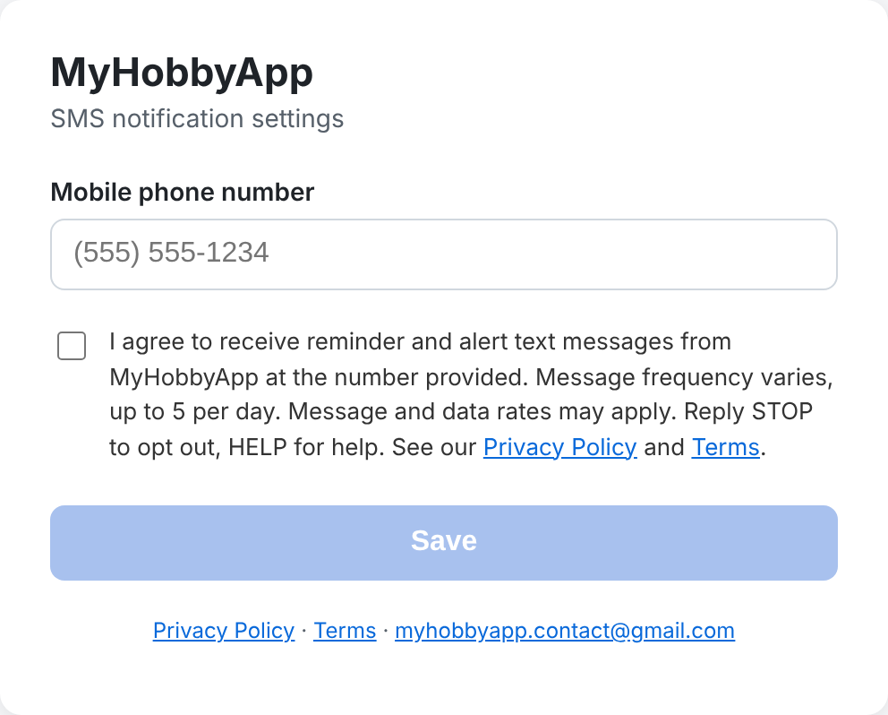
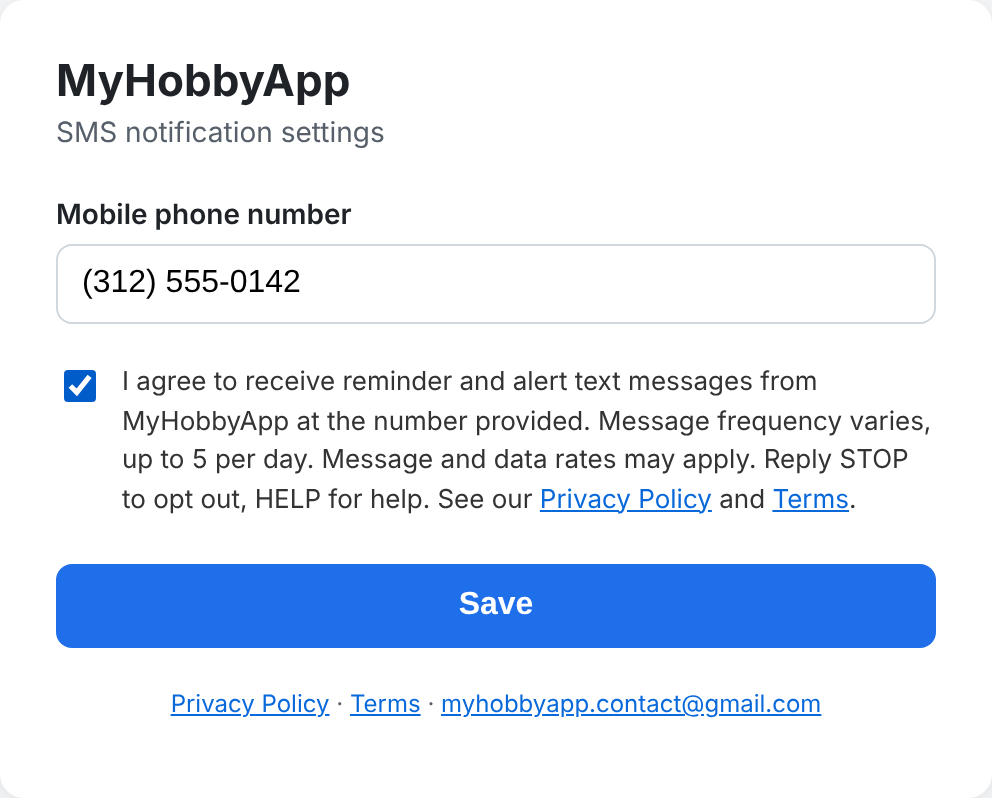

# MyHobbyApp SMS Opt-In Process
 
MyHobbyApp sends reminder and alert text messages to one person only: the account owner, at their own mobile number. No messages are sent until the owner completes the steps below.
 
## Step 1: Open the SMS settings page
 
The owner opens the MyHobbyApp SMS settings page. The consent box is **unchecked by default** and the Save button is disabled.
 

 
## Step 2: Enter a mobile number
 
The owner types their own mobile phone number into the **Mobile phone number** field.
 
## Step 3: Read and accept the consent statement
 
The owner checks the consent box. The box is next to this text:
 
> I agree to receive reminder and alert text messages from MyHobbyApp at the number provided. Message frequency varies, up to 5 per day. Message and data rates may apply. Reply STOP to opt out, HELP for help. See our Privacy Policy and Terms.
 
The Privacy Policy and Terms links are shown with the consent statement and at the bottom of the page.
 
## Step 4: Save
 
The Save button is enabled only after the box is checked. Clicking Save completes the opt-in.
 

 
## After opting in
 
- **Messages:** Reminders and alerts, up to 5 per day.
- **Cost:** Message and data rates may apply.
- **Opt out:** Reply **STOP** at any time. One confirmation is sent, then no further messages.
- **Help:** Reply **HELP**, or email [myhobbyapp.contact@gmail.com](mailto:myhobbyapp.contact@gmail.com).
## Related pages
 
- [Privacy Policy](privacy.md)
- [Terms of Use](terms.md)
 
